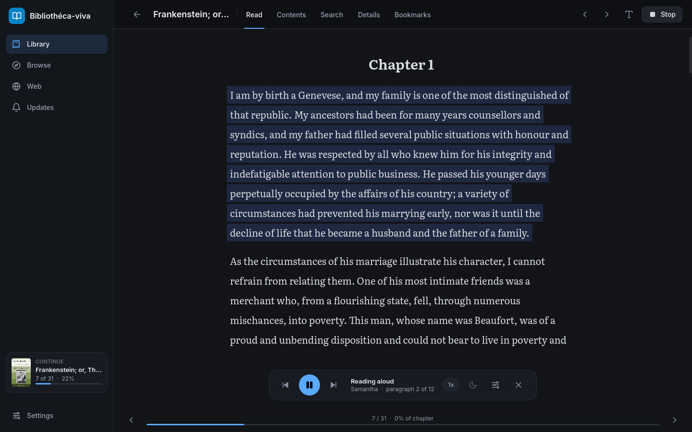

# Bibliothéca-viva

An ebook reader with text-to-speech, library sync over WebDAV, and a plugin system for fetching books from web serial sites. Built with **Godot 4.7** (GDScript, Compatibility renderer, so it targets desktop, Android, iOS and web; Windows, macOS, Linux and Android builds are set up).

## Features

- **Library**: import EPUB and TXT files (cover, metadata, table of contents), or follow web serials. Filters, including a **Tag** filter, live in the top bar, and the search box matches titles, authors and tags.
- **Book page** (the reader's Details tab): edit an imported book's title, author, tags and description, change its cover (PNG, JPEG or WebP), see its word count (saved / total), or delete it. **Add chapters from EPUB** adds a newer EPUB of the same serial (say `c486-496` after `c1-485`) to the book. Importing an EPUB whose title matches a book you have (ignoring a chapter range at the end) offers the same. Only new chapters are added; chapters the book already has (same number or same text) are skipped, so overlapping files are fine. On a web serial, **Add chapters from EPUB** fills chapters you haven't downloaded from an EPUB of the same book, and adds the chapters the site has taken down (say, stubbed after publication) in their place.
- **Reader**: Literata/Inter fonts, dark/sepia/light themes, and layout settings for font size, line and paragraph spacing, text width, side margins, alignment (left, justified, centred) and first-line indent. Remembers your position. Tabs: Read, Contents, Search, Details, Bookmarks.
- **Bookmarks**: right-click a paragraph (long-press on a phone) and choose **Bookmark this paragraph…**, optionally with a name. Bookmarked paragraphs show a small sign. The **Bookmarks** tab lists them in reading order with their chapter and first words; click one to go there, or rename or remove it.
- **Search** (the reader's Search tab, or Ctrl/Cmd+F): finds text in a book, from chapter x to chapter y (**This chapter** and **Whole book** set the range quickly). Plain text ignores case; with **Regex** on, the pattern is used as written (add `(?i)` to ignore case). It searches the text as the reader shows it, after your text rules. Click a result to open the chapter there with the match marked. Only chapters on this device are searched: in a web serial, it says how many chapters in the range aren't downloaded (their RSS preview is searched, if there is one).
- **Text-to-speech**: uses the platform's own voices through Godot's `DisplayServer.tts_*` API. Highlights and follows the paragraph or sentence being read, and moves on to the next chapter. You can configure:
  - voice, speed, pitch, volume, and a custom test sentence
  - reading by paragraph or by sentence (switchable while reading), with separate pauses between sentences, between paragraphs, after headings, and before the next chapter
  - automatic sentence splitting for very long paragraphs
  - whether chapter titles and headings are read, and whether lines without words (`* * *`) are skipped
  - highlight style (background, underline, colour, none), follow-along scrolling, and continuing to the next chapter
  - a sleep timer (minutes, or "end of chapter") on the player's moon button
  - a quick-settings panel on the player bar, and sentence skip buttons

  On Android, reading continues with the screen off or another app open. A media notification (also on the lock screen and Bluetooth headset buttons) has play/pause, sentence back/forward and stop. The next 5 chapters are loaded in advance, so reading carries on into them in the background.
- **Text rules** (Settings → Text rules): find-and-replace rules, as plain text or regex, with "ignore case" and "whole word" options. Each rule applies to **speech only** (fix pronunciation, don't read `[system notices]`), **text only** (clean up what you see), or **both**, for all books or just one. Rules run top to bottom and can be reordered, switched off, and copied or pasted as JSON. The rule editor has a live test box that shows the *shown* and *spoken* results, with a "Speak test" button. In the reader, select text and right-click it to create a rule from the selection. A few ready-made examples are included.
- **Web tab** (built-in browser, desktop): the system web view (WebKit on macOS, WebView2 on Windows, WebKitGTK on Linux) via [godot-wry](https://github.com/doceazedo/godot_wry). You browse normally, and since it's a real browser, sites' bot checks work as usual. On a chapter page:
  - **Listen** reads the page aloud with the app's TTS settings and speech rules, highlighting the paragraph on the page itself. Double-click a paragraph to start reading from there.
  - **Auto-next** opens the site's "Next chapter" link when a chapter ends and keeps listening. If a bot check appears, it waits until you've passed it.
  - **Save as I go** stores every chapter you open in your library, so the Reader has the full text offline. On a site with a plugin, opening a novel's page fills in its complete chapter list, which upgrades RSS-only books. **Add to library** works from a novel page or a chapter.
  - **Site rules** (the globe button next to the address, or Settings → Sites): where a site keeps its chapter text, what inside it to skip (author notes, ads), its next/previous links and its chapter title, as CSS selectors. Without a rule the app finds the text by itself; a rule wins over what a plugin finds.
  - Nothing is crawled in the background. The app only reads pages you have open. (A plugin may load a novel's full chapter list the way the site's own "show all" button does.)
- **Plugins** (Settings → Plugins): every site the app can search, add books from and download chapters from is a plugin, kept in its own repository. The app itself has no site code. Plugins are installed after the app is built:
  - from a link to a plugin, or from a plugin repository (added once, then it shows what's there and offers updates). Works on every device, phones included.
  - from a folder on the computer (desktop).
  - by Sync: plugins installed on one device are copied to your other devices.

  A plugin is a `plugin.json` and a GDScript file, plus an optional script that recognises the site's pages in the Web tab. Plugins that only make plain HTTP requests work on Android too. See [PLUGINS.md](PLUGINS.md) for how to write one. Plugins run with the same access as the app, so the app asks before installing one. Without any plugins, the Web tab still reads, listens to and saves any site.

  The app goes easy on sites: it sends each site one request at a time, with a pause after each (1 second, or what the site's plugin asks for). It backs off when a site says it's busy, and what you're reading goes ahead of background checks.
- **Updates**: new chapters across followed serials, grouped by date.
- **Saved searches** (on sites whose plugin supports them): do a search with any filters, then press **Save search** in the Web tab or paste the link in Browse → Add by URL. Saved searches are links in Updates → Saved searches; the app never fetches them by itself. When you open one in the Web tab, works that weren't on it the last time are highlighted. On Android they open in your browser.
- **Sync between devices** (Settings → Sync): keeps the library, saved chapters (including ones saved in the Web tab), covers, book details, bookmarks, reading position, text rules, site rules, saved searches, settings and installed plugins the same on all your devices, through a folder on any WebDAV server (Koofr has 10 GB free; Nextcloud works too). Syncs at start, shortly after changes, every 10 minutes and when closing. Each device only ever writes its own folder (a small index plus a file per book, so a sync only sends and fetches the books that changed), chapter files are written once and never changed (a book's first upload, or any time many chapters are sent at once, bundles them into a few compressed packs, so a big library or book syncs in far fewer requests; chapters an older version sent one by one are packed once too, so a new device pulls everything quickly), and the server's folder listing is the only index, so an interrupted sync is simply finished by the next one. When two devices change the same thing, the most recent change wins (per book, per setting); chapters saved on any device are kept. The selected voice, plugins' own settings and which saved-search results you've seen stay per device. The WebDAV password is kept in the system's credential store: the Keychain on macOS, DPAPI on Windows, the Android Keystore on Android, and the Secret Service (GNOME Keyring, KWallet) on Linux, where `secret-tool` must be installed. Without one, it falls back to an encrypted file in the data folder.
- **Layout**: primary navigation in the left sidebar; secondary navigation (tabs and actions) in the top bar. Below 820 px wide, the sidebar collapses to an icon rail and the tabs move to a second row.

## Install

Builds are on the [releases page](https://github.com/alsderda/bibliotheca-viva/releases):

- **Windows**: `bibliotheca-viva-Setup-<version>.exe`. Run it; run a newer one to update.
- **macOS** (Apple Silicon and Intel): `bibliotheca-viva-<version>.dmg` (drag the app to Applications) or the `.app` in `bibliotheca-viva-<version>-macos.zip`. The app isn't notarized by Apple, so the first time macOS won't open it: go to System Settings → Privacy & Security and click **Open Anyway**.
- **Linux** (x86_64): `bibliotheca-viva-<version>-x86_64.AppImage`. Make it executable (`chmod +x`) and run it. The Web tab needs WebKitGTK (`libwebkit2gtk-4.1`) and reading aloud needs speech-dispatcher; most desktop distributions have both.
- **Android**: `bibliotheca-viva-<version>.apk`. Open it on the phone to install (allow installing from your browser or file manager when asked).

## Development

Build, run and test instructions, and the layout of the code, are in [docs/DEVELOPMENT.md](docs/DEVELOPMENT.md).

## Disclaimer

For sync, use a WebDAV storage (or account) just for this app, with no important data on it. The app should only ever write inside its own sync folder, but a bug or an update could break that.

Bibliothéca-viva is provided "as is", without warranty of any kind, express or implied, including but not limited to the warranties of merchantability, fitness for a particular purpose and noninfringement. Use it at your own risk. See sections 15 and 16 of the [GPL-3.0](LICENSE).

## Known limits

- The Web tab is desktop-only (godot-wry doesn't support Android/iOS). It's a native layer drawn on top of the app, so app popovers can't overlap it.
- Many sites show the app's own HTTP client a bot check. The app doesn't get around them: plugins say so and offer the Web tab, where the real browser passes the check. Bot checks depend on the site and the network.
- Export presets exist for Windows, macOS, Linux and Android. Add others in the editor (Project → Export).
- The macOS app is signed ad-hoc, not notarized, so macOS asks once before the first launch.
- Plugins aren't signed; the app warns before installing one.

## License

Bibliothéca-viva is free software under the [GNU General Public License v3.0](LICENSE). You may use, change, share and sell it, as long as what you distribute stays under the GPL-3.0 with its source available.

Third-party parts keep their own licenses (also listed under Settings → About → Credits): [Godot Engine](https://godotengine.org) ([MIT](https://godotengine.org/license)), [Inter](https://github.com/rsms/inter) ([SIL OFL](assets/fonts/OFL-Inter.txt)) and [Literata](https://github.com/googlefonts/literata) ([SIL OFL](assets/fonts/OFL-Literata.txt)), [godot-wry](https://github.com/doceazedo/godot_wry) ([MIT](addons/godot_wry/LICENSE)), and icons drawn in the [Lucide](https://lucide.dev) style. Plugins carry their own licenses.

## How it was made

Almost all of the code in this project was written by AI (Claude, through Claude Code), with a person directing the work, testing it and reviewing the changes.
